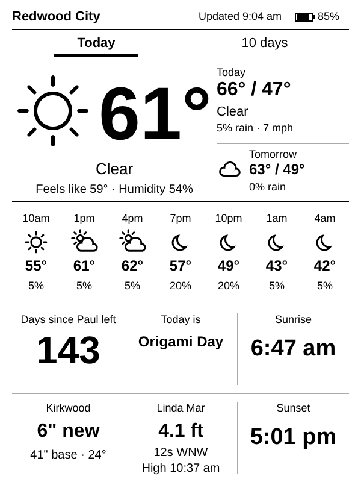
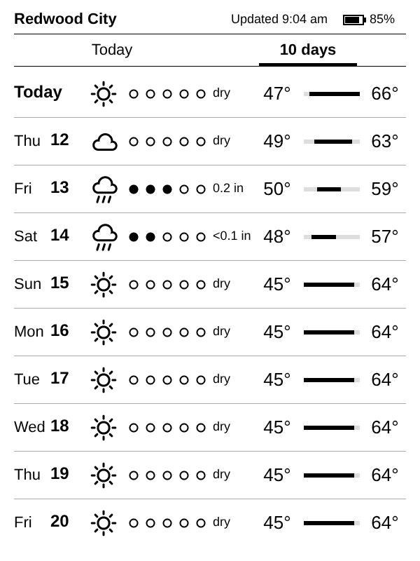

# Kindle weather dashboard (Kindle Basic 10th gen)

An e-ink weather dashboard for a jailbroken Kindle: current conditions, an hourly strip and a 10-day forecast for Redwood City, California, plus a bottom card with six extra tiles. It updates over Wi-Fi about once an hour and sleeps in between, so it can sit on a wall for weeks on a charge.

<p>
  
  
</p>

*Previews rendered on a computer with sample data; on the Kindle the font is Amazon Ember.*

## Credit

This is an adaptation of **[re-kindle](https://github.com/abdenourgnx/re-kindle) by [abdenourgnx](https://github.com/abdenourgnx)**, shared on r/ClaudeAI as *"Instead of collecting dust, Claude makes your old Kindle useful again."* The idea, the design of both screens, the icons, and almost all of the core code (fetching, the battery-saving sleep loop, the drawing protocol, the touch handling and the 10-day layout) are theirs. Their version runs on a Kindle 7th gen with KUAL and shows the weather and prayer times for Vienna.

All I did was get it running on a different Kindle and change what it shows. If you like this, go star the original.

The original repository doesn't include a license, so its code remains the author's. This fork is shared with credit, for reference; if you want to reuse the code, check with the original author.

## What I changed

**Getting it to run on a Kindle Basic 3 (10th gen, firmware 5.18.1, jailbroken with SpiderCat)**
- **Drawing:** the bundled FBInk is a soft-float build, and 5.18 firmware is hard-float, so it uses the hard-float FBInk that KOReader ships (`/mnt/us/koreader/fbink`), falling back to the bundled one.
- **Launching:** SpiderCat setups use scriptlets rather than KUAL, so there are two scriptlets for the library (`Weather Dashboard` and `Weather Dashboard Stop`). The KUAL menu still works if you have it.
- **Touchscreen:** this model's touch panel is `/dev/input/event2` (cyttsp5), and the events are read with finger down/up (`BTN_TOUCH`) to tell taps, swipes and holds apart.
- **Touch gestures:** the Kindle's own pull-down menus listen at the top and bottom edges, which made the original top-of-screen tabs open the Kindle menu instead. Now you swipe left / tap the right half for 10 days, swipe right / tap the left half for Today, and hold a finger down for 3 seconds to exit. Taps near the edges are ignored.
- **Awake indicator:** after pressing the power button, the header shows an "Awake · hold to exit" badge (with a full refresh) so you know taps will register. It goes back to Today and to sleep 20 seconds after the last touch.
- **Stability:** the loop moves itself out of the library app's cgroup (so closing the library can't kill it), runs from a copy in internal memory (so plugging into a computer can't pull the scripts away), and if it's ever stopped unexpectedly it un-pauses the Kindle UI and turns Wi-Fi back on instead of leaving the Kindle looking frozen.
- **USB:** it never suspends while plugged in or in USB drive mode, so the Kindle stays mounted on the computer.
- **Log:** `extensions/dashboard/dashboard.log` records each fetch, draw, sleep and touch for troubleshooting.

**Content**
- Redwood City, in °F, mph and inches, with a 12-hour clock.
- The prayer-times card is replaced by six tiles:
  - **Days since Paul left:** a day counter from a date you set (`PAUL_DATE` in `loop.sh`).
  - **Today is:** the day's fun holiday, from a local list (`holidays.txt`, one `MM-DD,Name` line per day). This repo ships a few example lines; fill in your own.
  - **Kirkwood:** new snow in the last 24 hours, base depth and temperature, from the Open-Meteo model for the resort's coordinates (a weather model, not the resort's official snow report).
  - **Linda Mar:** wave height, swell period and direction (Open-Meteo marine) and the next high or low tide (NOAA, Pillar Point Harbor).
  - **Sunrise** and **Sunset**.
- The snow, surf and tide sources refresh every 3 hours; the weather every hour, with no refreshes from 1am to 7am.

**Tooling:** `scriptlets/Dashboard-Probe.sh` is a one-tap probe that records a Kindle's firmware, FBInk builds, input devices, fonts and network access, and runs a short touch test. It's what I used to adapt the code to this model. `check.sh` has new cases for the tiles, units and data parsers.

## Installing

You need a jailbroken Kindle with KOReader installed (for its FBInk).

1. Set `PAUL_DATE` near the top of `extensions/dashboard/loop.sh` (YYYY-MM-DD), and fill in `extensions/dashboard/holidays.txt`. To use a different place, change `PLACE`, `LAT`, `LON` and the source coordinates in the same section.
2. Plug in the Kindle and copy the `extensions` folder to the top level of the Kindle drive, and the two `Weather Dashboard` scriptlets from `scriptlets/` into its `documents` folder.
3. Eject, make sure Wi-Fi is on, and tap **Weather Dashboard** in the library.

Exit by holding a finger on the screen for 3 seconds (press the power button first if it's asleep). Exit before plugging the Kindle into a computer. If anything gets stuck, run **Weather Dashboard Stop**, or hold the power button for 40 seconds to restart.

## Checks (on a computer)

```sh
sh extensions/dashboard/check.sh     # prints "ok"
sh -n extensions/dashboard/loop.sh
```

## Data sources

- Weather, snow and surf: [Open-Meteo](https://open-meteo.com/) (free, no key)
- Tides: [NOAA Tides and Currents](https://tidesandcurrents.noaa.gov/)
- Drawing: [FBInk](https://github.com/NiLuJe/FBInk) by NiLuJe

Built with Claude, like the original.
